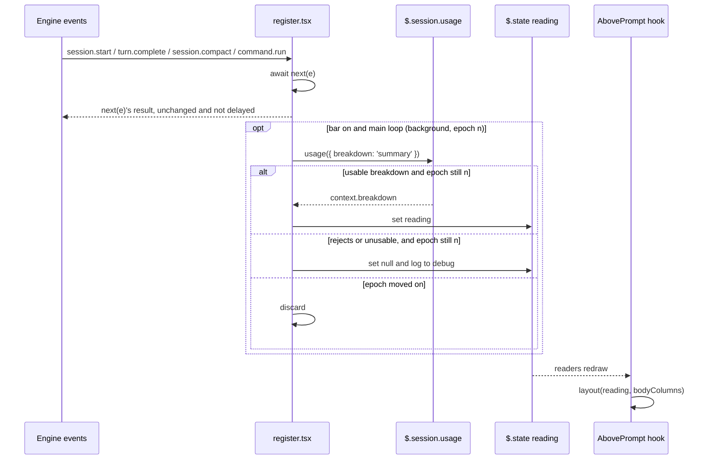

# Spec: context-bar mod
From: [intent.md](intent.md). Status: draft.

## Requirements

- **R1.** When the bar is on, the `AbovePrompt` band shows the context
  window broken down by category, in three parts:
  - a header row: `◆ context` on the left and
    `<used> of <window> · compacts at <N>%` on the right;
  - a bar row, one cell per column, in the band's width;
  - a wrapping legend, one entry per category.
- **R2.** All figures share one denominator, the window: the breakdown's
  `rawMaxTokens`.
  - **used:** each `kind: 'used'` row. The header's `<used>` is
    `totalTokens`.
  - **free:** the `kind: 'free'` row's tokens, as the API gives them. Free is
    never computed as window minus used.
  - **reserved:** the `kind: 'buffer'` row (the compaction reserve).
  - **left out:** `kind: 'deferred'` rows, which sit outside the window.
  - **missing rows:** a missing `free` or `buffer` row counts as 0 tokens.
  - **over the window:** if `totalTokens > rawMaxTokens`, free and reserved
    show 0 and the bar is all used cells.
- **R3.** The bar is exactly `width` cells. Its parts appear in this order:
  used rows in `/context` order, then free, then reserved at the right end.
  Cells are whole: no eighth-block glyphs. Cells are apportioned in three
  steps, and every part's count is a whole number ≥ 0, with the counts
  summing to `width`:
  1. **Denominator.** `D` is the sum of the parts' tokens (used + free +
     reserved, after R2's over-window zeroing). The header still shows the
     window; `D` only shares out cells. Over the window, the used parts
     therefore split the whole bar in proportion. If `D` is 0, the whole bar
     is free cells.
  2. **Largest remainder.** Each part gets `floor(tokens / D × width)`
     cells. The cells left over go one each to the parts with the largest
     fractional remainders; ties go to the part earlier in bar order. A part
     with 0 tokens never gets a cell.
  3. **Minimum of one.** Let `k` be the number of parts with tokens above 0.
     - If `k ≤ width`, every such part that ended up with 0 cells takes one
       cell from the part that has the most cells (ties: the later one in
       bar order). The donor always has at least 2 cells, because `width`
       cells are shared among `k ≤ width` parts and one of them has 0.
     - If `k > width`, the minimum applies only to the `width` largest parts
       by tokens (ties: earlier in bar order). The rest may get 0 cells and
       are then absent from the bar. The legend still lists them.
- **R4.** Each part's cells are drawn with a glyph in the theme colour its
  row carries (`ContextCategory.color`, a theme key):
  - `█` for used cells;
  - `░` for free cells;
  - `▒` for reserved cells, dimmed.
- **R5.** Each legend entry is `■ <label> <tokens> <pct>`. The swatch takes
  the row's colour, and `<pct>` is dimmed.
  - **Order:** used rows in `/context` order, then `free`, then `reserved`
    only when its tokens are above 0.
  - **Free entry:** written `free <tokens>`, with no percentage, as in the
    screenshot.
  - **Labels:** chosen by `kind` first. `free` and `buffer` are always
    labelled `free` and `reserved`. A used row is labelled through this map
    (unknown names fall back to the lowercased name):

    | `/context` name | label |
    | --- | --- |
    | `System prompt` | `system prompt` |
    | `System tools` | `tools` |
    | `MCP tools` | `mcp tools` |
    | `Custom agents` | `agents` |
    | `Memory files` | `memory files` |
    | `Skills` | `skills` |
    | `Messages` | `messages` |

  - **Tokens:** written short:
    - under 1000 as is (`0`, `950`);
    - under 1M to one decimal in `k`, with the decimal dropped from 10k up
      (`4.2k`, `17k`, `897k`);
    - from 1M to two decimals in `M`, with trailing zeros dropped (`1M`,
      `1.02M`).

    The header uses the same format.
  - **Percentages:** whole numbers. Any non-zero share is shown as at least
    `1%`.
- **R6.** The header's right part:
  - `<used> of <window>`, followed by `· compacts at <N>%` when
    `isAutoCompactEnabled` is true and `autoCompactThreshold` is set;
  - `<N>` is `round(autoCompactThreshold / rawMaxTokens × 100)`.
- **R7.** The band's layout depends on `w = e.props.bodyColumns`. No row is
  ever wider than `w`, and any text that would not fit is cut with `…`.

  | `w` | Layout |
  | --- | --- |
  | ≥ 60 | header, bar, legend (R1) |
  | 40–59 | header with the right part shortened to `<used>/<window> · <N>%` (or `<used>/<window>` with auto-compact off); bar |
  | 20–39 | one row: `◆ <used>/<window> ` followed by the bar in the remaining columns (the prefix is at most 14 columns, so the bar has at least 6) |
  | < 20 | nothing: `next(e)` |

  The header's left and right parts are separated by at least one space.
  When they cannot both fit, the right part wins and `context` is cut.
- **R8.** The band steps aside (`return next(e)`) when any of these holds:
  - the bar is off;
  - `e.props.hasSurvey` is true;
  - no reading is stored;
  - `w < 20`.
- **R9.** A reading is refreshed at these points, and only while the bar is
  on:
  - **`session.start`:** this also runs after a mod reload, so a running
    session gets a reading at once;
  - **after each main-loop `turn.complete`:** an event with `agentId` is
    skipped;
  - **after a main-loop `session.compact`:** one with no `agentId` whose
    trigger is not `precompute`, once `next(e)` resolves. This happens
    whether the compaction ran or was vetoed with `{ skip }`: a vetoed one
    left the conversation as it was, so a fresh reading is still correct;
  - **when `/context-bar` turns the bar on.**

  Refreshes are not timed or retried.
- **R10.** A refresh calls `$.session.usage({ breakdown: 'summary' })`, and
  never the `full` breakdown. A refresh that rejects, or comes back with no
  `context.breakdown` or with no `used` row, clears the stored reading, so
  the band steps aside (R8). The next successful refresh restores it.
- **R11.** A main-loop compaction (as in R9) clears the stored reading
  before calling `next(e)`. Usage from before the compaction is never shown
  after it.
- **R12.** Refreshes never delay the engine, and failures are contained.
  - A refresh is started in the background (`void refresh($)`) once
    `next(e)` resolves. The hook returns `next(e)`'s result straight away,
    unchanged, without awaiting `usage()`. A slow or never-settling
    `usage()` therefore delays no turn, compaction or command. The band
    catches up when the refresh lands.
  - A refresh error is caught inside `refresh`. It writes one
    `$.ui.log(…, { to: 'debug' })` line and is never rethrown.
- **R13.** A refresh that has become obsolete is never published.
  - The module keeps a counter, `epoch`. These steps each increment it:
    starting a refresh, clearing the reading at the start of a compaction
    (R11), and turning the bar off.
  - A refresh records the epoch it started under. When `usage()` settles,
    it writes its result (a reading, or `null` on failure) only if the
    epoch is unchanged.
  - So among overlapping refreshes the latest one wins. A refresh started
    before a compaction or before the bar was turned off is discarded.
- **R14.** `/context-bar` is registered in `session.start`. It takes no
  argument, `on` or `off`.
  - No argument toggles the bar.
  - `on` and `off` set it.
  - Anything else changes nothing and answers
    `Usage: /context-bar [on|off]`.
  - It answers `Context bar on.` or `Context bar off.` as `{ text }`.
  - It never sends anything to the model.
- **R15.** Whether the bar is on is kept in `$.store` under the key
  `isOn`. That store is a JSON file of the mod's own, under the user's
  Claude Code configuration directory. The setting is user-wide, defaults
  to off, and survives mod reloads and restarts. Turning the bar off clears
  the stored reading.
- **R16.** The mod is display only. It adds no prompt section, sends no
  message, and changes no tool call.
- **R17.** The mod loads on every machine that stows the `claude` package,
  with nothing to install: no npm dependencies, no per-machine step.

## Design

### Files

```
claude/.claude/
├── settings.json                       # CLAUDE_CODE_PLUGIN_DIRS gains the mod
└── mods/context-bar/
    ├── .claude-plugin/plugin.json      # name, version 0.1.0, description, types
    ├── hooks/hooks.json                # { "modules": ["./register.tsx"] }
    ├── hooks/register.tsx              # events, command, render hook
    ├── hooks/layout.ts                 # pure: reading → rows (R2–R7)
    ├── hooks/layout.test.ts            # claude plugin test: layout cases
    ├── hooks/register.test.tsx         # claude plugin test: events and band
    ├── types/index.d.ts                # PluginState contract
    ├── tsconfig.json                   # extends ./.claude-plugin/types/tsconfig.json
    └── intent/show-context-breakdown/  # intent.md, spec.md
```

`tsconfig.json` is the same one-line config mermaid-ascii uses:
`{ "extends": "./.claude-plugin/types/tsconfig.json" }`. The file it
extends, and the engine types beside it, are written by the engine into
`.claude-plugin/types/` once it has loaded the mod. Root `.gitignore`
already excludes `claude/.claude/mods/*/.claude-plugin/types/`, so those
generated types are never committed.

Before the mod has loaded once (on a fresh clone, or in CI), that file is
missing and `tsc -p` cannot run. Type-check against the API file the
plugin-authoring skill writes instead (`types/claude-code.d.ts` in the
skill's folder). Use a throwaway `tsconfig.json` outside the mod folder whose
`include` names that file and the mod's `hooks/` and `types/`.

### Flow



### Reading

`register.tsx` reduces the breakdown to only what the layout needs, and
stores that:

```ts
type Part = { label: string; tokens: number; color: string }
type Reading = {
  used: Part[]            // kind 'used', in /context order
  free: Part              // kind 'free', or { label: 'free', tokens: 0, color: 'inactive' }
  reserved: Part | null   // kind 'buffer'; null when absent
  totalTokens: number
  window: number          // rawMaxTokens
  compactsAt: number | null // percent, or null when auto-compact is off
}
```

Storing the reduced reading keeps the render hook cheap. It also means that
when the API's own shape changes, only the reducer needs updating.

### Layout

`layout.ts` exports `layout(reading: Reading, width: number): Row[] | null`.
It is pure, so every case in R2–R7 is tested without the engine. A `Row` is
a list of `{ text, color?, dim? }` spans. The render hook maps each span to
`<Text color dimColor>` inside a `<Box flexDirection="column">`. `null`
means "step aside" (`w < 20`).

The legend wraps itself: `layout` packs whole entries into rows of at most
`width` columns, with two spaces between entries. An entry wider than
`width` is cut with `…`. Widths are counted in display columns. Every glyph
the band uses (`◆ ■ █ ░ ▒ · …`) is one column wide, and labels are ASCII.

### The render hook

`on('ui.render', { component: 'AbovePrompt' }, …)`:

1. If R8 says the band steps aside, `return next(e)`.
2. `rows = layout(reading, e.props.bodyColumns)`. If it is `null`,
   `return next(e)`.
3. Return the tree drawn from `$.ui.resolve(e)`.

The hook reads `isOn` from a state atom that mirrors the store. It never
calls `usage()` and never awaits anything except state reads.

`AbovePrompt` is raised on the `terminal` and `desktop` surfaces only.
Other surfaces simply never show the band.

### Events

"Start a refresh" below always means `void refresh($)`. It is never
awaited (R12).

- **`session.start`:**
  1. `await next(e)`.
  2. Register `/context-bar`.
  3. Copy `$.store.get('isOn')` into the `isOn` atom.
  4. If on, start a refresh.
  5. Return the result.
- **`turn.complete`:** `await next(e)`. If the bar is on and
  `e.agentId === undefined`, start a refresh. Return the result.
- **`session.compact`:** applies to main-loop compactions only, meaning no
  `agentId` and a trigger other than `precompute`:
  1. Bump `epoch` and clear the reading (R11, R13).
  2. `await next(e)`.
  3. If the bar is on, start a refresh, whether the result is a compaction
     or `{ skip }` (R9).
  4. Return the result unchanged, `skip` included.
- **`command.run` for `context-bar`:** parse the args (R14), then write the
  store and the atom. Turning it on starts a refresh. Turning it off bumps
  `epoch` and clears the reading. Return `{ text }`.

`refresh($)`:

```ts
async function refresh($) {
  const mine = ++epoch
  let next: Reading | null = null
  try {
    next = reduce(await $.session.usage({ breakdown: 'summary' }))
  } catch (err) {
    $.ui.log(`context-bar: refresh failed: ${err}`, { to: 'debug' })
  }
  if (mine !== epoch) return // obsolete: discard (R13)
  try {
    await set($, reading, next)
  } catch (err) {
    $.ui.log(`context-bar: state write failed: ${err}`, { to: 'debug' })
  }
}
```

`reduce` returns `null` when there is no breakdown or no `used` row (R10).
Because `refresh` is never awaited, nothing may escape it. Both the call and
the write are caught.

### State contract

```ts
interface PluginState {
  'context-bar': {
    isOn: boolean
    reading: Shaped<Reading | null>
  }
}
```

`reading` is shaped (`shape: 'reading-1'`), so a reload that changes
`Reading` declines a value an earlier version stored. `isOn` lives in
`$.state` only as a mirror. `$.store` is the source of truth across
sessions.

### Loading

`claude/.claude/settings.json`:

```json
"CLAUDE_CODE_PLUGIN_DIRS": "~/.claude/mods/mermaid-ascii:~/.claude/mods/context-bar"
```

## How each constraint in the intent is met

| Constraint | How |
|---|---|
| Data source | `$.session.usage({ breakdown: 'summary' })`, reduced by `kind` (R2, R10). |
| Summary counting | `breakdown: 'summary'` only (R10). |
| Never blocks drawing | `usage()` runs in event hooks. The render hook reads state only. |
| Narrow terminals | The layout tiers in R7, which have a 20-column minimum and never overflow. |
| No npm dependencies | No `render/` dir and no `package.json` (R17). |
| Lives in dotfiles | `claude/.claude/mods/context-bar/`, loaded through `CLAUDE_CODE_PLUGIN_DIRS` (R17). |
| Accounting | One denominator, the API's free row, and reserved shown and reconciled (R2, R3). |
| Failed refresh | Clear and step aside, recover on the next event, contained (R10–R13). |
| Toggle scope | `$.store`, which is user-wide and survives reloads and restarts, with a refresh when the bar is turned on (R9, R15). |

## Open questions from the intent

All are decided here.

- **Labels:** the map in R5, chosen by `kind` first and falling back to the
  lowercased name.
- **`/context-bar` arguments:** it toggles with no argument, and also takes
  `on` and `off` (R14).
- **Partial cells:** whole cells only (R3). An eighth-block glyph can't
  carry two category colours in one cell without background colours, which
  the band's `Text` does not set reliably on every surface.
- **Showing the reservation:** shown, as the dim tail segment, so the
  figures reconcile (R2–R5). This is the one deliberate change from the
  video.

## Verification

- `claude plugin validate` on the mod folder. Run `tsc -p` on the mod folder
  once the engine has written `.claude-plugin/types/`; before that, use the
  fallback tsconfig described under "Files".
- `claude plugin test` with `hooks/layout.test.ts`, apportionment (R3). In
  every case below, every count is ≥ 0 and the counts sum to the bar width:
  - window 100, width 60, three used rows of 100 tokens each (over the
    window): `[20, 20, 20]` and no free or reserved cells;
  - 2 large used rows plus 5 small ones at width 72: each small row gets 1
    cell, taken from the largest;
  - more non-zero parts than cells: 9 non-zero parts of distinct, similar
    sizes in a 6-cell bar. The 6 largest get one cell each, and the other 3
    get 0 but stay in the legend;
  - the 20–39 tier: at width 20 the bar is what the `◆ <used>/<window> `
    prefix leaves (at least 6 cells for every short-token width R5 allows),
    and the apportionment rules hold within it;
  - `D = 0`: the whole bar is free.

  The rest of `hooks/layout.test.ts`:
  - the intent's example: at width 72, the used cells, the free cells and
    the reserved cells add up to 72, the header reads `90k of 1M · compacts
    at 99%`, and the legend lists `system prompt 4.2k 1%` … `free 897k`
    `reserved 13k`;
  - auto-compact off: no `compacts at`, no reserved entry or cells, and
    free fills the rest;
  - a 0-token category gets no cells, while a 1-token category gets one;
  - over the window: free and reserved are 0, all cells are used, and the
    header reads `1.02M of 1M`;
  - widths 80, 60, 59, 40, 39, 20 and 19 match R7's tiers, and no row is
    wider than the width;
  - short tokens: `0`, `950`, `4.2k`, `17k`, `897k`, `1M`, `1.02M`.
- `claude plugin test` with `hooks/register.test.tsx`. The test's own hooks
  stand in for `session.usage`, `store.get` and `store.set`:
  - off by default, the band passes through and `usage()` is never called;
  - `/context-bar` turns the bar on and writes `isOn: true`. The band then
    draws, and the next session's start reads the setting back;
  - `/context-bar off` clears the reading and the band passes through;
    `/context-bar bogus` answers the usage text and changes nothing;
  - a main-loop `turn.complete` refreshes, but one with an `agentId` does
    not;
  - `usage()` rejecting clears the band and writes a debug log, and the
    turn's result is still returned; the next successful turn brings the
    band back;
  - a breakdown with no `used` row clears the band;
  - a main-loop compaction: while `next(e)` is pending the band has
    stepped aside, and once it resolves a fresh reading draws. A
    `precompute` trigger and a subagent compaction change nothing;
  - a vetoed compaction: `next(e)` resolves `{ skip: 'reason' }`. The hook
    returns exactly that object, and a fresh reading then draws, so the
    band does not stay hidden;
  - **timing, with a deferred `usage()`:** the stand-in returns a promise
    the test resolves by hand.
    - `turn.complete`, `session.compact` and `/context-bar on` each resolve
      their hook's result while `usage()` is still pending;
    - a `usage()` that never settles leaves every later event hook
      unaffected;
  - **obsolete results:**
    - a refresh started before a compaction and resolved after it is
      discarded; only the post-compaction refresh's reading draws;
    - a refresh started, then `/context-bar off`, then resolved, leaves the
      band hidden;
    - two overlapping refreshes resolved out of order: the later-started
      one's reading wins;
  - `hasSurvey` makes the band pass through.
- Live: after merge, `stow -t ~ -R claude` from the main checkout, then
  start a session and run `/context-bar`. Compare the band's figures with
  `/context`. Then narrow the terminal across 60, 40 and 20 columns.

## Areas of concern

1. **`usage()` at `session.start`.** The breakdown may not be ready before
   the first API response, because `summary` uses the last response's usage.
   If it comes back with no `used` rows, R10 hides the band until the first
   turn ends. That is acceptable, but confirm it live.
2. **Theme keys as colours.** `Text color` accepts a `ThemeKey`, and the
   rows' `color` values are theme keys. Confirm that every key `/context`
   uses is drawn on both terminal and desktop.
3. **Summary vs `/context`.** `summary` is a local estimate, while
   `/context` counts with the API. The live check should expect small
   differences, not identical figures.
4. **The band's own height.** At 60+ columns the band is 3–4 rows, and
   `e.props.maxRows` caps it. The layout does not trim to `maxRows`; the
   engine scrolls instead. Revisit this if the scrolling looks wrong.
5. **`epoch` does not survive a reload.** It is a module variable, so a
   reload resets it, and a refresh started by the old module could still
   publish after the reload. The reload's own `session.start` refresh
   overwrites it moments later. The window is a reload landing mid-refresh,
   which happens only during development, so this is accepted.
