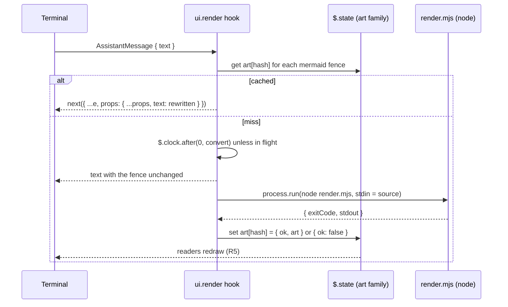

# Spec: mermaid-ascii mod
From: [intent.md](intent.md). Status: draft.

## Requirements

- **R1.** In the terminal transcript, every closed ```` ```mermaid ```` fence
  in an assistant reply is drawn as text art in place of its source.
  - A fence opens with three or more backticks or tildes followed by
    `mermaid` (case-insensitive, surrounding spaces allowed) and closes with
    the same character, at least as many times, on a line of its own.
  - A fence that is still open (a reply mid-stream) is left as source until
    it closes.
  - Several fences in one reply are each converted on their own.
- **R2.** A block is drawn as its original fence, unchanged, when:
  - the converter fails or exits non-zero, for example on an unsupported
    diagram type or a syntax error;
  - the converter is missing (no `node`, or `npm ci` not run);
  - the widest line of the art is wider than the transcript can draw it
    (`e.viewport.columns` minus the reply's indent). When the surface does
    not report a viewport, the art is used.
- **R3.** Only the drawing changes. The hook rewrites `e.props.text` and
  passes everything else on as received. The stored message, ctrl+o, the
  transcript file and the model's context keep the Mermaid source.
- **R4.** Only the `terminal` surface is rewritten. On `desktop`, `vscode`
  and `mobile` the hook returns `next(e)` untouched.
- **R5.** Drawing never waits on the converter. A block with no cached
  result is drawn as source first, then redrawn as art once its result
  lands.
- **R6.** Each block is converted at most once per session. Results are
  cached by block, failures included, and the same source in another reply
  reuses the cached result.
- **R7.** Art uses Unicode box drawing with no colour: `colorMode: 'none'`,
  `useAscii: false`. Message text may hold no control characters other than
  tab and newline, so ANSI colour codes are never emitted.
- **R8.** A missing converter is reported once per session with a toast
  naming the setup command. It is never reported per block or per redraw.
- **R9.** The mod loads on every machine that stows the `claude` package,
  with no per-machine plugin install. The one per-machine step is
  `npm ci` for the converter (R12).

## Design

### Files

```
claude/.claude/
├── settings.json                        # env.CLAUDE_CODE_PLUGIN_DIRS names the mod
├── tests/mermaid-ascii/run.sh           # converter suite (package test convention)
└── mods/mermaid-ascii/
    ├── .claude-plugin/plugin.json       # name, version 0.1.0, description, types
    ├── hooks/hooks.json                 # { "modules": ["./register.tsx"] }
    ├── hooks/register.tsx               # ui.render hook + conversion
    ├── hooks/register.test.tsx          # claude plugin test
    ├── types/index.d.ts                 # PluginState contract
    ├── render/package.json              # beautiful-mermaid 1.1.3, exact pin
    ├── render/package-lock.json         # committed; npm ci installs from it
    ├── render/render.mjs                # stdin source -> stdout art
    └── intent/render-mermaid-as-ascii/  # intent.md, spec.md
```

`render/node_modules/` is gitignored.

### Flow



### The render hook

`on('ui.render', { component: 'AssistantMessage' }, …)`:

1. `e.surface !== 'terminal'` → `return next(e)` (R4).
2. Find the closed mermaid fences in `e.props.text` (R1). None →
   `return next(e)`.
3. For each fence, `hash = fnv1a32(source)` (the module has no crypto; a
   32-bit FNV-1a over the trimmed source is enough to key a session cache).
   Read `art` member `hash` from `$.state`; the read subscribes this message
   to that member.
4. Miss and not in flight → schedule `convert(hash, source)` with
   `$.clock.after(0, …)` so the write happens outside drawing. The in-flight
   set is a module variable: a reload forgets it, and the next draw schedules
   again, which is harmless.
5. Build the new text. A fence with `{ ok: true, art }` that fits (R2)
   becomes a `text` fence holding the art, with a fence of backticks one
   longer than the longest backtick run in the art. Every other fence stays
   as written.
6. `return next({ ...e, props: { ...e.props, text } })`. `isFirstOfReply`,
   `isSummary` and `onScreen` pass through as received (R3).

### Conversion

`convert(hash, source)`:

```ts
const r = await $.process.run(['node', 'render.mjs'], {
  cwd: `${$.plugin.root}/render`, stdin: source, timeoutMs: 5000,
})
```

- Exit 0 → `{ ok: true, art: stdout.trimEnd() }`.
- Non-zero exit → `{ ok: false }` (R2, R6).
- Rejection (no `node`, timeout) → `{ ok: false }`. The first rejection
  whose stderr or message names a missing module or executable toasts the
  setup hint once (R8), guarded by a session `$.state` flag.

`render/render.mjs` reads all of stdin, calls
`renderMermaidASCII(source, { useAscii: false, colorMode: 'none' })` and
writes the result to stdout; any throw prints the message to stderr and
exits 1.

### State contract

```ts
interface PluginState {
  'mermaid-ascii': {
    art: StateFamily<{ ok: true; art: string } | { ok: false }>
    warnedMissing: boolean
  }
}
```

Session-scoped `$.state` only. Persisting results in `$.store` across
sessions is left out until resumed sessions show it is needed.

### Loading

`claude/.claude/settings.json` gains:

```json
"env": { "CLAUDE_CODE_PLUGIN_DIRS": "~/.claude/mods/mermaid-ascii" }
```

`CLAUDE_CODE_PLUGIN_DIRS` is read from the `env` block of
`~/.claude/settings.json`, which is now stowed directly, so stowing
`claude` is enough (R9). Each listed folder loads as a `--plugin-dir`, and
an interactive session watches it, so edits reload with no install step.

### Runtime: node, not bun

The converter runs on `node`, which mise provisions from
`mise/.config/mise/config.toml` (`node = "24"`). `bun` is not in the
Brewfile or the mise config, so depending on it would add a new tool to
every machine. Plain `.mjs` needs no TypeScript step.

## How each constraint in the intent is met

| Constraint | How |
|---|---|
| Converter: beautiful-mermaid | `render/package.json` pins `1.1.3` exactly, and `package-lock.json` fixes its dependency tree. |
| Display only | The hook rewrites `e.props.text` of the drawing. It writes no message, appends no row and adds no prompt section (R3). |
| Never blocks drawing | Conversion runs from a `$.clock.after` timer, and the render hook only reads state (R5). |
| Cached, failures included | `art` holds `{ ok: false }` for failed blocks; a member that exists is never converted again (R6). |
| Unicode box drawing | `useAscii: false`, `colorMode: 'none'` (R7). |
| Lives in dotfiles | The mod sits in the `claude` package, and `settings.json` loads it from `~/.claude/mods/` (R9). |

## Open questions from the intent

Both are decided here.

- **Loading:** `CLAUDE_CODE_PLUGIN_DIRS` in the stowed `settings.json`.
  `claude-sync` no longer exists (removed in `925eca4`), and
  `settings.json` is stowed directly.
- **Converter install:** a `package.json` beside the mod, installed with
  `npm ci` in `~/.claude/mods/mermaid-ascii/render` once per machine.
  `node_modules` is gitignored. Vendoring a bundle into the hooks module was
  rejected: it puts a large generated file in the repo, and the mod runtime
  has not been shown to run the library.

## Verification

- `claude/.claude/tests/mermaid-ascii/run.sh`: pipes fixtures through
  `render.mjs` and checks a flowchart, a sequence diagram and a state
  diagram each exit 0 with box-drawing characters and no `ESC` byte, and an
  invalid diagram exits 1.
- `claude plugin validate` and `tsc -p` on the mod folder.
- `claude plugin test` (`hooks/register.test.tsx`), with `process.run`
  stubbed by the test's own hook:
  - a reply with a flowchart fence is first drawn as source, then as art
    after the stubbed conversion settles;
  - a failed conversion keeps the fence and is not run again on redraw;
  - art wider than the viewport keeps the fence;
  - an unclosed fence and a reply with no fence are unchanged;
  - `desktop` passes through untouched.
- Live: after merge and `stow -t ~ claude` from the main checkout, run
  `/show-me` on a topic that yields a sequence diagram; the reply shows art,
  and ctrl+o shows the Mermaid source.

## Areas of concern

1. **Scheduling from a render hook.** `$.clock.after` called from inside
   `ui.render` is assumed to run its callback outside drawing, where
   `$.state.set` is allowed. The first plugin test proves or refutes this;
   if it fails, convert from `turn.complete` instead and accept that resumed
   transcripts draw source until redrawn.
2. **PATH in non-terminal launches.** `node` comes from mise, which only
   shells put on PATH. A session started by the desktop app may not find it;
   it then falls back to source and toasts (R8).
3. **Reply indent.** R2 assumes the terminal indents a reply by two
   columns. Confirm against a live transcript and adjust.
