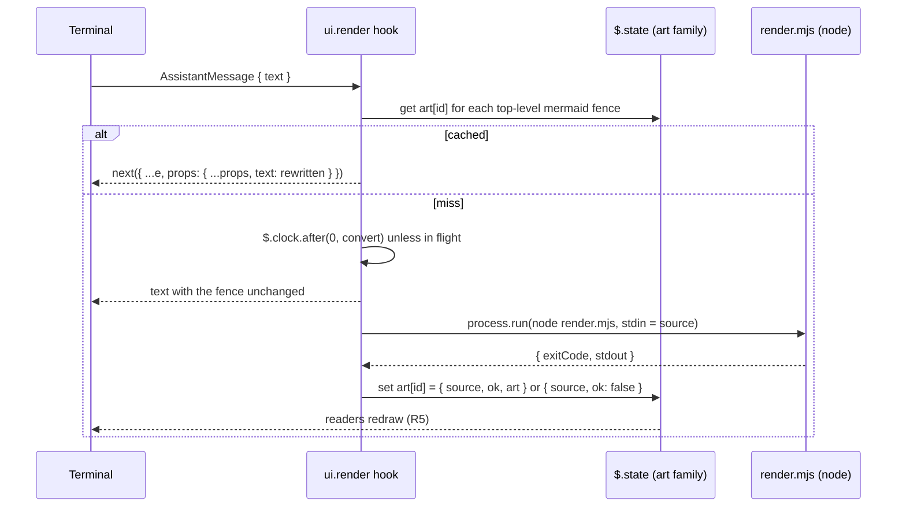

# Spec: mermaid-ascii mod
From: [intent.md](intent.md). Status: draft.

## Requirements

- **R1.** In the terminal transcript, every closed ```` ```mermaid ```` fence
  in an assistant reply is drawn as text art in place of its source.
  - A fence opens with three or more backticks or tildes followed by
    `mermaid` (case-insensitive, surrounding spaces allowed) and closes with
    the same character, at least as many times, on a line of its own.
  - A fence that is still open (a reply mid-stream) is left as source until
    it closes.
  - Only top-level fences count. A mermaid fence quoted inside another code
    fence (a longer ```` ```` ```` or `~~~` fence around a Markdown example)
    is part of that fence's literal text and stays as written.
  - Several fences in one reply are each converted on their own.
- **R2.** A block is drawn as its original fence, unchanged, when:
  - the converter fails or exits non-zero, for example on an unsupported
    diagram type or a syntax error;
  - the converter is missing (no `node`, or `npm ci` not run);
  - the widest line of the art is wider than the transcript can draw it
    (`e.viewport.columns` minus the reply's indent). Width is counted in
    display columns, not string length: East Asian Wide and Fullwidth
    characters and emoji count 2, combining marks and zero-width joiners 0,
    everything else 1, and a tab advances to the next multiple of 8. When
    the surface does not report a viewport, the art is used.
- **R3.** Only the drawing changes. The hook rewrites `e.props.text` and
  passes everything else on as received. The stored message, the
  transcript file and the model's context keep the Mermaid source. Whether
  the ctrl+o view shows the source or the art is unresolved: see "Areas of
  concern" 1.
- **R4.** Only the `terminal` surface is rewritten. On `desktop`, `vscode`
  and `mobile` the hook returns `next(e)` untouched.
- **R5.** Drawing never waits on the converter. A block with no cached
  result is drawn as source first, then redrawn as art once its result
  lands.
- **R6.** Each distinct diagram source is converted at most once per module
  load. Results are cached by source, failures included, and the same source
  in another reply reuses the cached result. A mod reload may convert a
  source a second time if its first conversion was still running when the
  module reloaded; nothing else does.
- **R7.** Art uses Unicode box drawing with no colour: `colorMode: 'none'`,
  `useAscii: false`. Message text may hold no control characters other than
  tab and newline, so ANSI colour codes are never emitted.
- **R8.** A missing converter is reported once per session with a toast
  naming the setup command. It is never reported per block or per redraw.
  "Missing" means `node` cannot start or the `beautiful-mermaid` package
  cannot be found. An invalid diagram, an unsupported type or a timeout is
  a plain failure: cached, drawn as source, no toast.
- **R9.** The mod loads on every machine that stows the `claude` package,
  with no per-machine plugin install. The one per-machine step is
  `npm ci` for the converter (see "Install").
- **R10.** `render/node_modules/` is neither committed nor stowed:
  `.gitignore` excludes it from git, and `claude/.stow-local-ignore`
  excludes it from Stow.

## Design

### Files

```
claude/.stow-local-ignore                # Stow's defaults restated + node_modules (R10)
claude/.claude/
├── settings.json                        # env.CLAUDE_CODE_PLUGIN_DIRS names the mod
├── tests/mermaid-ascii/run.sh           # converter suite (package test convention)
└── mods/mermaid-ascii/
    ├── .claude-plugin/plugin.json       # name, version 0.1.0, description, types
    ├── hooks/hooks.json                 # { "modules": ["./register.tsx"] }
    ├── hooks/register.tsx               # ui.render hook + conversion
    ├── hooks/register.test.tsx          # claude plugin test
    ├── types/index.d.ts                 # PluginState contract
    ├── render/package.json              # beautiful-mermaid 1.1.3, exact pin
    ├── render/package-lock.json         # committed; npm ci installs from it
    ├── render/render.mjs                # stdin source -> stdout art
    └── intent/render-mermaid-as-ascii/  # intent.md, spec.md
```

`render/node_modules/` is gitignored and Stow-ignored (R10).

### Flow



### The render hook

`on('ui.render', { component: 'AssistantMessage' }, …)`:

1. `e.surface !== 'terminal'` → `return next(e)` (R4).
2. Scan `e.props.text` line by line, tracking any open code fence. A fence
   opening while none is open starts a block; it closes on a line of the
   same character repeated at least as many times. Only blocks whose info
   string is `mermaid` are candidates, so a mermaid fence quoted inside
   another fence is never seen (R1). None → `return next(e)`.
3. For each candidate, `id = fnv1a32(source)` (the module has no crypto).
   The hash only names the `$.state` member; it is never trusted as the
   identity. Read member `id`; the read subscribes this message to it. The
   cached value carries the `source` it was made from, and it counts as a
   hit only when that `source` equals this block's. A value made from
   another source (a hash collision) counts as neither hit nor miss: the
   block is drawn as source and not converted, so a collision can never
   show the wrong diagram or overwrite another block's result.
4. Miss and not in flight → schedule `convert(id, source)` with
   `$.clock.after(0, …)` so the write happens outside drawing. The in-flight
   set is a module `Set` of full source strings, not hashes. A reload
   forgets it, and the next draw schedules again (R6).
5. Build the new text. A block with `{ ok: true, art }` that fits (R2)
   becomes a `text` fence holding the art. Its fence is backticks,
   `max(3, longestBacktickRun(art) + 1)` long, so plain box art gets
   ```` ``` ```` and art holding backticks still cannot close it early.
   Every other block stays as written.
6. `return next({ ...e, props: { ...e.props, text } })`. `isFirstOfReply`,
   `isSummary` and `onScreen` pass through as received (R3).

### Conversion

`convert(id, source)`:

```ts
// realPath: render.mjs and node_modules live in the repo checkout, which
// ~/.claude/mods/... reaches only through Stow's symlinks (R10).
const dir = (await $.fs.stat(`${$.plugin.root}/render`, { resolve: true })).realPath
const r = await $.process.run(['node', `${dir}/render.mjs`], {
  cwd: dir, stdin: source, timeoutMs: 5000,
})
```

`render.mjs` exit codes are the contract between the two sides:

| Outcome | Cached value | Toast (R8) |
|---|---|---|
| exit 0 | `{ source, ok: true, art: stdout.trimEnd() }` | no |
| exit 1: the library threw (invalid or unsupported diagram) | `{ source, ok: false }` | no |
| exit 3: `beautiful-mermaid` not found | `{ source, ok: false }` | once |
| rejected because `node` cannot start | `{ source, ok: false }` | once |
| rejected on timeout | `{ source, ok: false }` | no |

Exit codes, not stderr text, tell the cases apart. Any other exit code is
treated as exit 1. A rejection counts as "cannot start" when its error says
the executable was not found (`ENOENT`); every other rejection is treated as
a timeout. The toast fires at most once per session, guarded by the
`warnedMissing` state flag.

`render/render.mjs` reads all of stdin and loads the library with a dynamic
`import('beautiful-mermaid')` inside `try`. `ERR_MODULE_NOT_FOUND` for that
package exits 3; a static import would fail before any handler runs and
exit 1, indistinguishable from a bad diagram. It then calls
`renderMermaidASCII(source, { useAscii: false, colorMode: 'none' })` and
writes the result to stdout; a throw there prints the message to stderr
and exits 1. (The "no `import()`" rule applies to the mod's hooks module,
not to this node script.)

### Install

Once per machine, from the main checkout:

```sh
npm ci --prefix ~/workspace/dotfiles/claude/.claude/mods/mermaid-ascii/render
```

The toast in R8 shows this command.

### Stow

Stow does not read `.gitignore`. Without an exclusion, a restow that
descends into an existing `~/.claude/mods/mermaid-ascii/render/` directory
would link `node_modules` into the home directory. `claude/.stow-local-ignore`
excludes it. That file replaces Stow's default ignore list rather than
adding to it, so it restates the defaults that apply to this package (as
`git/.stow-local-ignore` does) and adds `^/\.claude/mods/[^/]+/render/node_modules$`.

`render.mjs` imports through its real path, so node resolves
`node_modules` from the repo checkout whether `~/.claude/mods` is one
folded link or a tree of per-file links.

### State contract

```ts
interface PluginState {
  'mermaid-ascii': {
    art: StateFamily<
      | { source: string; ok: true; art: string }
      | { source: string; ok: false }
    >
    warnedMissing: boolean
  }
}
```

Session-scoped `$.state` only. Persisting results in `$.store` across
sessions is left out until resumed sessions show it is needed.

### Loading

`claude/.claude/settings.json` gains:

```json
"env": { "CLAUDE_CODE_PLUGIN_DIRS": "~/.claude/mods/mermaid-ascii" }
```

`CLAUDE_CODE_PLUGIN_DIRS` is read from the `env` block of
`~/.claude/settings.json`, which is now stowed directly, so stowing
`claude` is enough (R9). Each listed folder loads as a `--plugin-dir`, and
an interactive session watches it, so edits reload with no install step.

### Runtime: node, not bun

The converter runs on `node`, which mise provisions from
`mise/.config/mise/config.toml` (`node = "24"`). `bun` is not in the
Brewfile or the mise config, so depending on it would add a new tool to
every machine. Plain `.mjs` needs no TypeScript step.

## How each constraint in the intent is met

| Constraint | How |
|---|---|
| Converter: beautiful-mermaid | `render/package.json` pins `1.1.3` exactly, and `package-lock.json` fixes its dependency tree. |
| Display only | The hook rewrites `e.props.text` of the drawing. It writes no message, appends no row and adds no prompt section (R3). |
| Never blocks drawing | Conversion runs from a `$.clock.after` timer, and the render hook only reads state (R5). |
| Cached, failures included | `art` holds `{ source, ok: false }` for failed blocks; a source with a cached value is never converted again (R6). |
| Unicode box drawing | `useAscii: false`, `colorMode: 'none'` (R7). |
| Lives in dotfiles | The mod sits in the `claude` package, and `settings.json` loads it from `~/.claude/mods/` (R9). |
| `node_modules` not committed or stowed | `.gitignore` and `claude/.stow-local-ignore` (R10). |

## Open questions from the intent

Both are decided here.

- **Loading:** `CLAUDE_CODE_PLUGIN_DIRS` in the stowed `settings.json`.
  `claude-sync` no longer exists (removed in `925eca4`), and
  `settings.json` is stowed directly.
- **Converter install:** a `package.json` beside the mod, installed with
  `npm ci` in the main checkout once per machine (see "Install").
  `node_modules` is excluded from git and Stow (R10). Vendoring a bundle into the hooks module was
  rejected: it puts a large generated file in the repo, and the mod runtime
  has not been shown to run the library.

## Verification

- `claude/.claude/tests/mermaid-ascii/run.sh`, against `render.mjs`:
  - a flowchart, a sequence diagram and a state diagram each exit 0 with
    box-drawing characters and no `ESC` byte;
  - an invalid diagram exits 1;
  - with `NODE_PATH` cleared and a copy of `render.mjs` in an empty temp
    directory (no `node_modules`), it exits 3.
- `claude/.claude/tests/mermaid-ascii/run.sh`, against Stow: with
  `render/node_modules` present, `stow -n -v -t <temp home> claude` (a dry
  run into an empty temp target, and again into one where
  `.claude/mods/mermaid-ascii/render/` already exists as a real directory)
  plans no link whose path contains `node_modules`.
- `claude plugin validate` and `tsc -p` on the mod folder.
- `claude plugin test` (`hooks/register.test.tsx`), with `process.run`
  stubbed by the test's own hook:
  - a reply with a flowchart fence is first drawn as source, then as art
    after the stubbed conversion settles;
  - the output fence: art with no backticks gets three; art holding a run
    of one, and a run of four, gets four and five;
  - a failed conversion (exit 1) keeps the fence, shows no toast and is not
    run again on redraw;
  - exit 3, and a rejection with `ENOENT`, each keep the fence and toast
    once, however many blocks fail; a timeout rejection does not toast;
  - an injected hash collision: two sources forced to the same member id
    are each drawn as their own source or art, never the other's;
  - a mermaid fence quoted inside a ```` ```` ```` markdown fence stays
    literal and is not converted;
  - art wider than the viewport keeps the fence, measured in display
    columns (a CJK label counts 2 per character);
  - an unclosed fence and a reply with no fence are unchanged;
  - `desktop` passes through untouched.
- Live: after merge, `npm ci` (see "Install") and `stow -t ~ claude` from
  the main checkout, run `/show-me` on a topic that yields a sequence
  diagram; the reply shows art. Open ctrl+o and record what it shows
  ("Areas of concern" 1).

## Areas of concern

1. **ctrl+o may show the art too.** The `AssistantMessage` render props
   carry no flag for the ctrl+o transcript. `UserMessage` and the tool rows
   have `isExpanded`, but `AssistantMessage` does not. The types say a
   rewrite "leaves the stored message alone (ctrl+o)", which does not settle
   whether ctrl+o draws through the same hook. Until the live check
   answers it, the spec promises only that the stored message is unchanged
   (R3). If ctrl+o shows the art, the source stays reachable in the
   transcript file, and a toggle to show it in the terminal is the later
   change the intent already lists.
2. **Scheduling from a render hook.** `$.clock.after` called from inside
   `ui.render` is assumed to run its callback outside drawing, where
   `$.state.set` is allowed. The first plugin test proves or refutes this;
   if it fails, convert from `turn.complete` instead and accept that resumed
   transcripts draw source until redrawn.
3. **PATH in non-terminal launches.** `node` comes from mise, which only
   shells put on PATH. A session started by the desktop app may not find it;
   it then falls back to source and toasts (R8).
4. **Reply indent.** R2 assumes the terminal indents a reply by two
   columns. Confirm against a live transcript and adjust.
